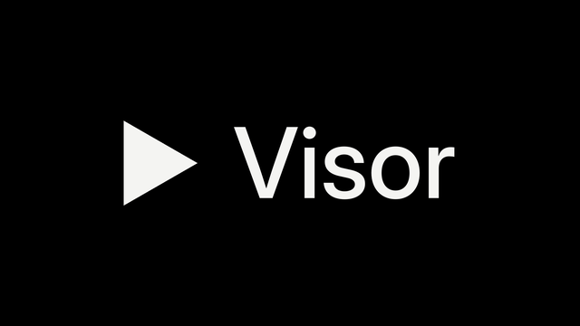

<div align="center">



**A clean, fast IPTV player for Fire TV and Android TV.**
Live TV with a real guide, movies and series with full detail pages, recordings, and in-app updates, all for your own Xtream Codes subscription.

[](https://github.com/aguado2323-rgb/visor-iptv/releases/latest)


</div>

---

## Why Visor

Most IPTV apps on Fire TV are cluttered and slow. Visor focuses on what you use every night: your channels, the guide, and what's new to watch. It loads each folder only when you open it, caches everything on the device, and remembers where you were.

## Features

### Home
- **Continue watching:** movies you left halfway and, for each series, the episode in progress or the next one. **OK** resumes at the exact second; **☰ Menu** opens the detail page or removes it from the row.
- **New movies showcase:** a large card with backdrop, synopsis, year, genre and rating. It rotates on its own; press **← →** to browse, **OK** to open.
- **New series shelf:** the latest series with cover and description.
- The layout is sized to the screen, so nothing is cut off on a 16:9 TV.

### Live TV
- Channels grouped in your provider's folders, with what's on now from the EPG.
- **Channel guide inside the player:** press **OK** or **←** while watching. It has two tabs, *This folder* and *Recent* (your last 15 channels), with progress bars and what's on next. **↑ ↓** zaps directly.
- **Full guide:** Visor downloads your provider's complete XMLTV guide once a day, so the grid covers up to 4 days ahead (and the last 6 hours). Move by 2 hours or by day, or with **⏪ ⏩** on the remote. Press OK on a show to watch it if it's on, or to record it once, daily or weekly.
- **Search the guide** by show name across all your channels ("when is the match on?").
- Channels without guide data can still be browsed and played from the grid. If your provider has no XMLTV guide, Visor falls back to the short per-channel guide.
- Favorite channels with **☰ Menu** on any channel.

### Movies and series
- Your provider's folders, plus **✦ Latest** (the 30 most recent additions) and **★ Favorites**.
- **Search** across the whole list, not just one folder. It ignores accents and case and matches several words.
- **Sort** any folder: recently added, oldest, release year (newest or oldest), A–Z or Z–A. Your choice is remembered.
- **Full-screen detail pages:**
  - **Movies:** original title, country, age rating, picture and sound quality (4K, HDR, 5.1…), cast, director, trailer, and *Continue* with time left.
  - **Series:** *Continue S2 · E3* from where you left off, seasons, and episode thumbnails with progress.
- **Back returns to the same poster**, so you keep browsing where you were.
- Artwork from your provider by default, or TMDB.

### Player
- **ExoPlayer or VLC,** chosen separately for live TV and for movies, series and recordings. You can also switch on the fly if a stream misbehaves.
- **Audio and subtitles panel** with every track the stream carries.
- **Scrubbable timeline:** hold **→** and the step grows (10 s → 30 s → 1 min → 5 min). Release to jump there.
- **Next episode** card with a 10-second countdown during the credits.
- **Picture format:** fit, fill or zoom, for 4:3 channels or streams with black bars. Remembered for next time.

### Recording
- One-press **REC** while watching, from the guide, or with a **new timer**: pick any channel, then a show from its guide or exact hours, once, daily, weekdays or weekly, with start and end margins.
- Choose where each recording is saved: internal storage or a USB drive. Each recording uses one extra connection to your provider.

### Everything else
- **Manage folders** for TV, movies and series: hide the ones you never use, reorder them, or lock them with the PIN. From **☰ Menu** on any folder, or all at once in *Settings → Folders*. Hidden and locked folders stay out of search, *Latest* and Home; locked ones close again when you leave the app.
- **Automatic list refresh** every 6 h, 12 h or 24 h, plus *Refresh now*.
- **In-app updates:** when a new release is published here, Visor offers it on launch and installs it with one click.
- **Backup and restore** of favorites, progress, recent channels, settings and scheduled recordings.
- **Light** and **true-black OLED** themes.
- **PIN lock** for Settings, or for the whole app.

## Install on Fire TV

**First time** (once, over ADB):

1. On the Fire TV, open **Settings → My Fire TV → Developer options** and turn on **ADB debugging**. Note the IP address under **About → Network**.
2. Download the APK from the [latest release](https://github.com/aguado2323-rgb/visor-iptv/releases/latest).
3. Install it from your computer:
   ```bash
   adb connect <fire-tv-ip>:5555
   adb install -r visor-x.y.z.apk
   ```
   Accept the prompt on the TV the first time.
4. Open Visor and sign in with your provider's server (with port), username and password. You can also paste the full M3U link into the server field; Visor splits it for you.

**After that,** updates arrive inside the app. The first time, Fire OS asks you to allow Visor to install apps; Visor takes you straight to that setting.

## Security

Your subscription details stay on your TV.

- **Encrypted at rest:** server, username and password are encrypted with AES-256-GCM using a key held in the Android Keystore. The key can't be exported.
- **No cloud backups:** app data is excluded from Android backup and device transfer. Visor's own backup file never contains your account.
- **System certificates only:** a proxy or a user-installed certificate can't read HTTPS traffic.
- **No URLs on disk or in logs:** stream URLs that contain credentials are built in memory at play time.
- **Optional PIN** for Settings or for the whole app.

**Limits:** if your provider redirects streams to plain `http://`, that part isn't encrypted. Anyone with ADB access to the TV while the app is open could inspect its memory, so turn ADB off when you don't need it.

## Build and release

GitHub Actions builds the APK on every push to `main`. You can download it from the run's *Artifacts*.

**Publishing a release:** create a release with a tag such as `v0.5.0` from `main`. The workflow builds it, attaches `visor-0.5.0.apk`, and every installed copy offers the update on next launch.

| Repository secret | Purpose |
|---|---|
| `VISOR_KEYSTORE_B64`, `VISOR_KEYSTORE_PASSWORD` | Fixed signing key, so updates install over the previous version |
| `TMDB_API_KEY` | Optional: enables TMDB artwork |

To build locally, open the folder in Android Studio and choose **Build → Build APK(s)**.

### Under the hood

Kotlin and Jetpack Compose · Media3 ExoPlayer · libVLC · OkHttp · kotlinx.serialization · Coil

```
app/src/main/java/com/visor/tv/
├── data/     Xtream API and cache, encrypted vault, favorites, recents, backup, updater
├── player/   ExoPlayer and VLC behind one interface, player UI, channel guide, seek bar
├── record/   recording service, alarms, schedule
└── ui/       theme, TV-focusable components, screens and detail pages
```

## Notes

Visor is a player only. It doesn't include, sell or link to any channels or content, and you need your own subscription. Use it only with content you're allowed to watch. The interface is in Spanish.
