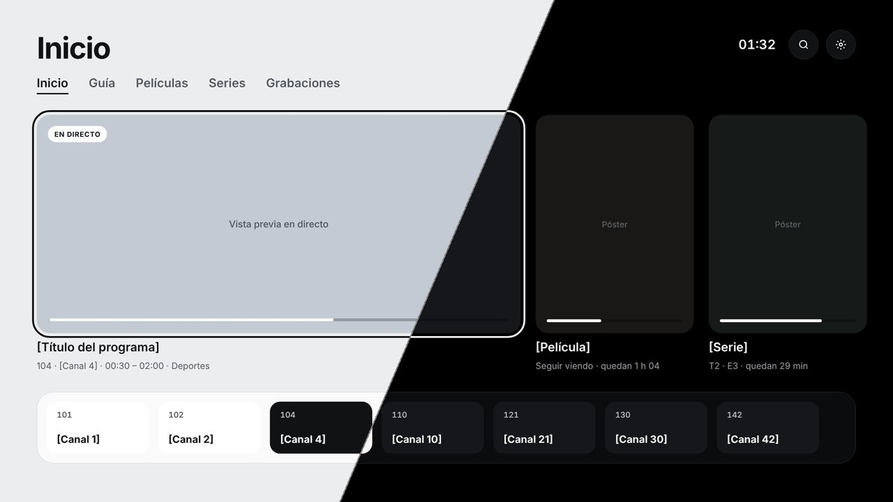
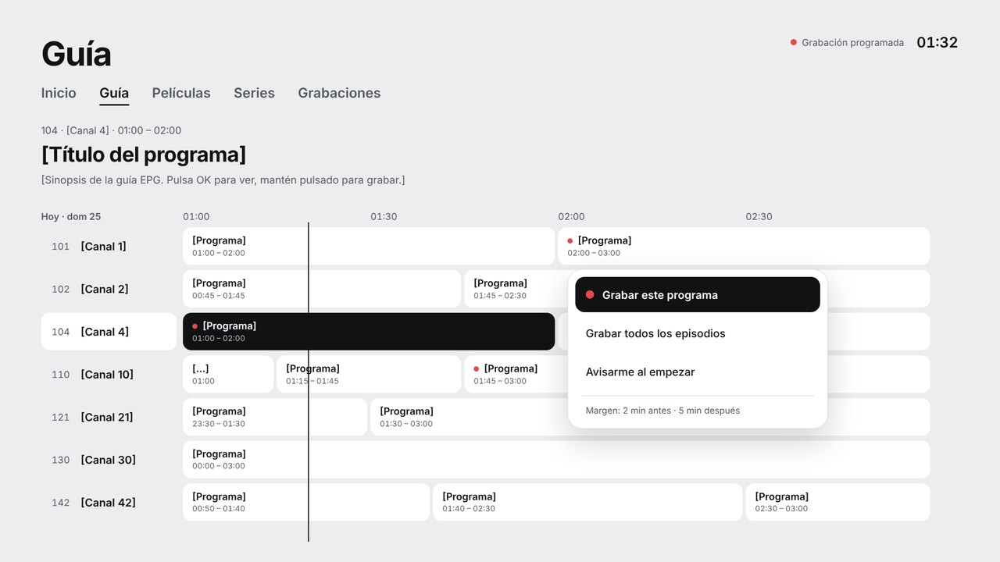
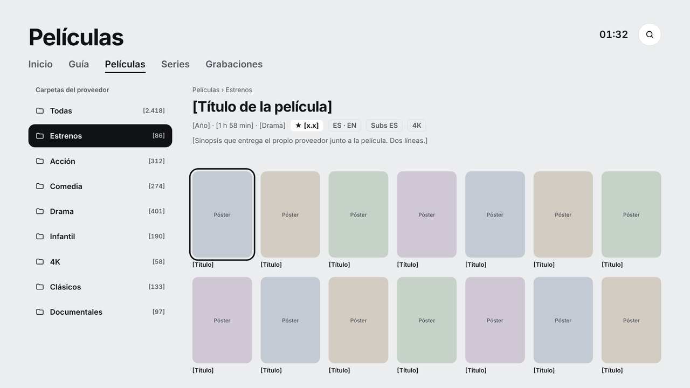
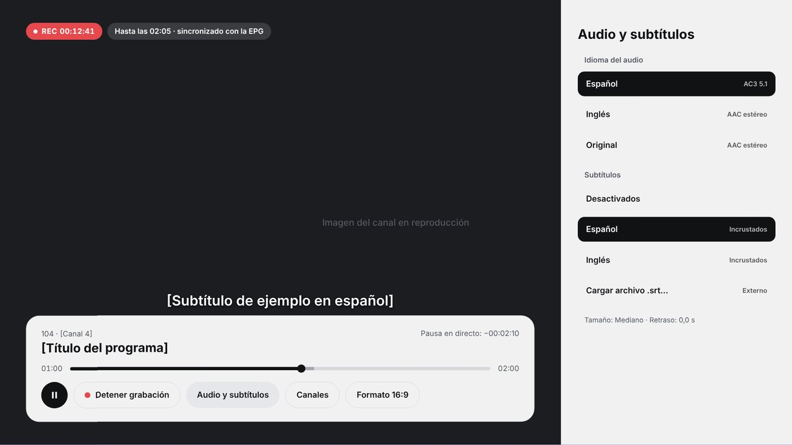
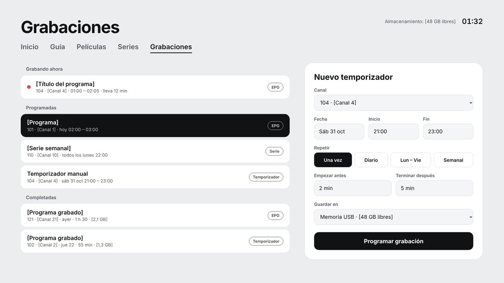
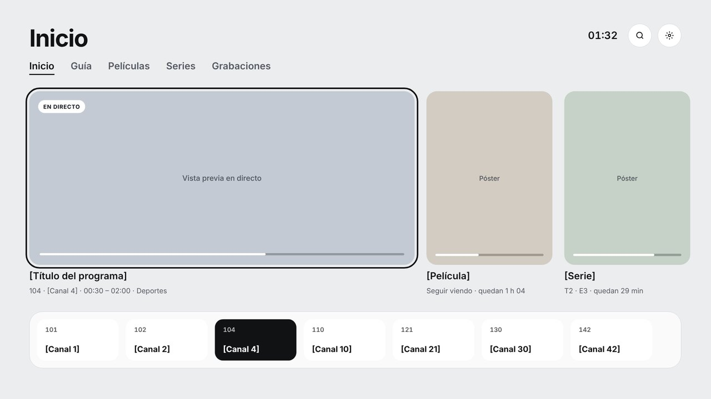
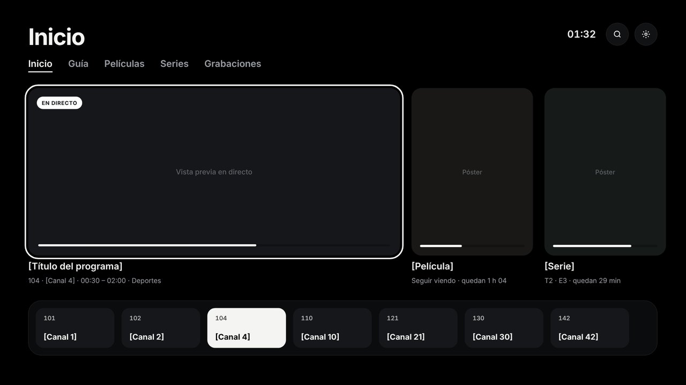
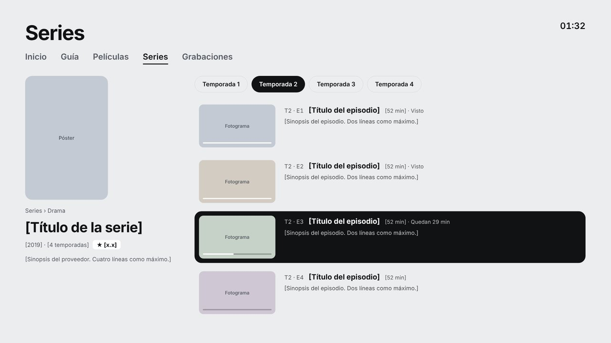
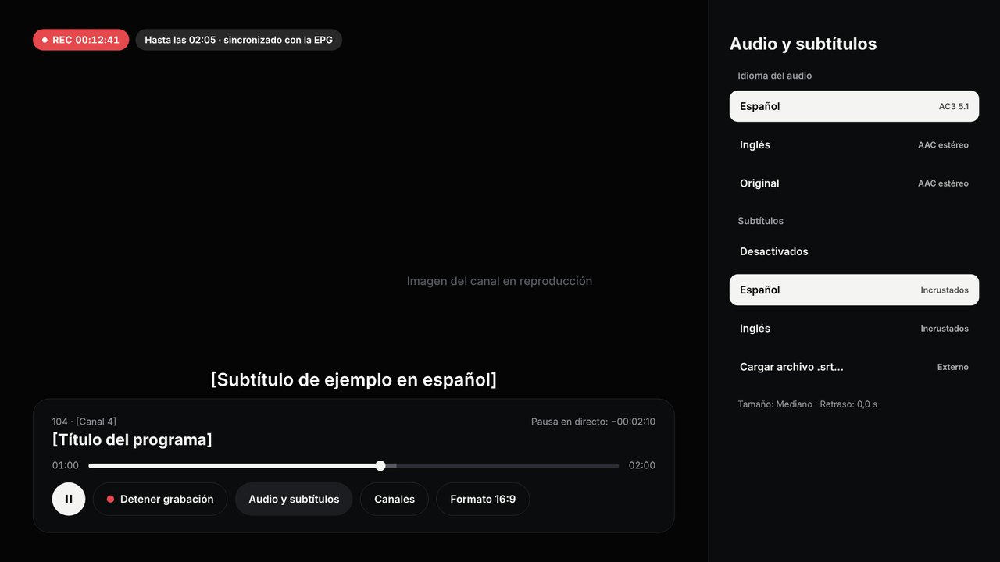

<div align="center">

# Visor

**A clean, fast IPTV player for Fire TV and Android TV.**
Live TV, a real program guide, movies, series and recordings, all for your Xtream Codes subscription, with nothing in the way.




</div>

---

## Why Visor

Most IPTV apps on Fire TV are cluttered and slow. Visor sticks to what you use every night: your channels, the guide, and your watchlist. It loads only what you open and caches everything else, so it starts fast.

<table>
<tr>
<td width="50%"></td>
<td width="50%"></td>
</tr>
<tr>
<td><b>Program guide.</b> A 3-hour EPG grid. Press OK on a show that's airing to watch it, or on a future one to record it once, every day or every week.</td>
<td><b>Movies and series by folder.</b> Your provider's categories, exactly as they are, with covers, plots and ratings. You can switch to TMDB artwork in Settings.</td>
</tr>
<tr>
<td width="50%"></td>
<td width="50%"></td>
</tr>
<tr>
<td><b>Audio and subtitles.</b> Switch audio language and subtitle track while you watch. Choose ExoPlayer or VLC per stream if a channel misbehaves.</td>
<td><b>Recordings.</b> One-press REC, recordings from the guide, or a manual timer. Saved to internal storage or a USB drive.</td>
</tr>
</table>

## Features

| | |
|---|---|
| **Live TV** | Provider folders, the current show from the EPG, ↑ ↓ to zap, live pause |
| **Guide** | 3-hour grid with a "now" line; record from any future slot |
| **Movies and series** | Folder browsing, detail pages, seasons and episodes, resume where you left off |
| **Favorites** | Separate lists for channels, movies and series; press **☰ Menu** on anything to add it |
| **Continue watching** | Resume movies and episodes from the home screen |
| **Two players** | ExoPlayer (hardware decoding, low latency) or libVLC (plays almost anything) |
| **Recording** | REC button, EPG-based, or timer: once, daily, weekdays or weekly, with start and end margins |
| **Themes** | Light, or true-black OLED |
| **Artwork** | From your provider by default, or TMDB with no setup on the device |

## Light and OLED themes

<table>
<tr>
<td width="50%"></td>
<td width="50%"></td>
</tr>
<tr>
<td width="50%"></td>
<td width="50%"></td>
</tr>
</table>

> These screenshots are design mockups. The app follows the same layout; text appears in Spanish, and titles and artwork come from your own provider.

## Security

Your subscription details stay on your TV, and only there.

- **Encrypted at rest.** Server, username and password are encrypted with AES-256-GCM using a key held in the Android Keystore. The key can't be exported, so a copy of the app's data is useless on another device.
- **No backups or transfers.** App data is excluded from Android cloud backup and device-to-device transfer.
- **System certificates only.** The app trusts only the TV's built-in certificates, so a proxy or a user-installed certificate can't read HTTPS traffic.
- **No URLs on disk or in logs.** Stream URLs that contain credentials are built in memory at play time and never saved or logged.
- **Optional PIN.** Lock Settings, or the whole app on launch.

**Limits.** If your provider redirects streams to plain `http://`, that leg isn't encrypted. Anyone with ADB access to the TV while the app is open could inspect its memory, so turn ADB off when you're not using it.

## Install on Fire TV

1. Go to **Actions**, open the latest green **Compilar APK** run, and download **visor-apk** under *Artifacts*.
2. On the Fire TV, open **Settings → My Fire TV → Developer options** and turn on **ADB debugging**, or allow apps from unknown sources.
3. From your computer:
   ```bash
   adb connect <fire-tv-ip>:5555
   adb install -r visor.apk
   ```
   You can also use the **Downloader** app on the Fire TV.
4. Open Visor and sign in with your provider's server (including the port), username and password.

Every build is signed with the same project key, so new versions install over the old one and keep your login, favorites and recordings.

## Build

GitHub Actions builds a release APK on every push to `main`. You can also start a build by hand from the Actions tab.

| Repository secret | Purpose |
|---|---|
| `VISOR_KEYSTORE_B64` | Base64 of the signing keystore, so updates install in place |
| `VISOR_KEYSTORE_PASSWORD` | Keystore and key password |
| `TMDB_API_KEY` | Optional: turns on the TMDB artwork option |

To build locally, open the folder in Android Studio and choose **Build → Build APK(s)**.

### Under the hood

Kotlin and Jetpack Compose · Media3 ExoPlayer · libVLC · OkHttp · kotlinx.serialization · Coil

```
app/src/main/java/com/visor/tv/
├── data/     Xtream API, on-disk cache, encrypted vault, favorites, TMDB
├── player/   ExoPlayer and VLC engines behind one interface, player UI
├── record/   recording service, alarms, schedule
└── ui/       theme, focusable TV components, screens
```

## Notes

Visor is a player only. It doesn't include, sell or link to any channels or content, and you need your own subscription. Use it only with content you're allowed to watch.
